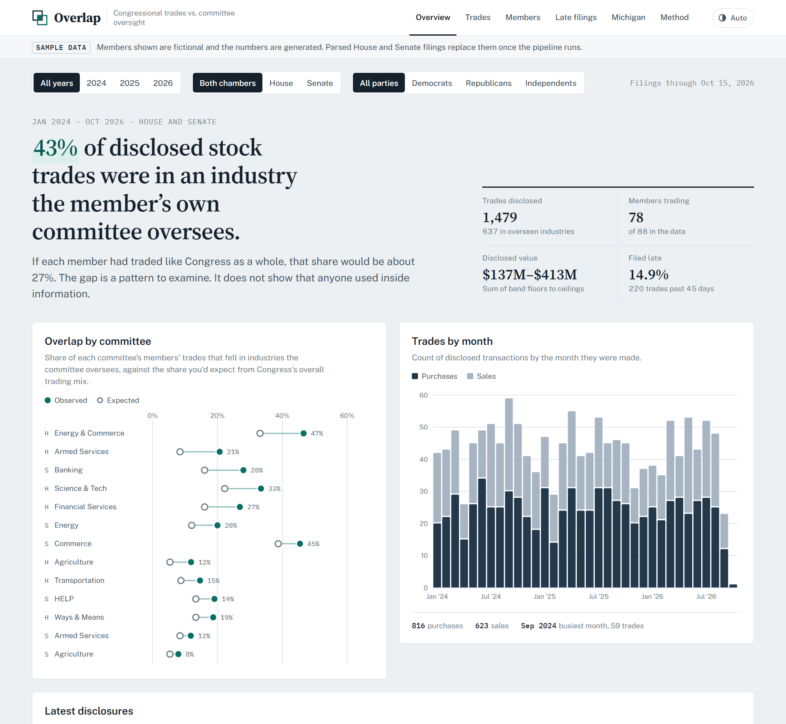
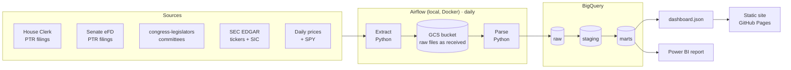
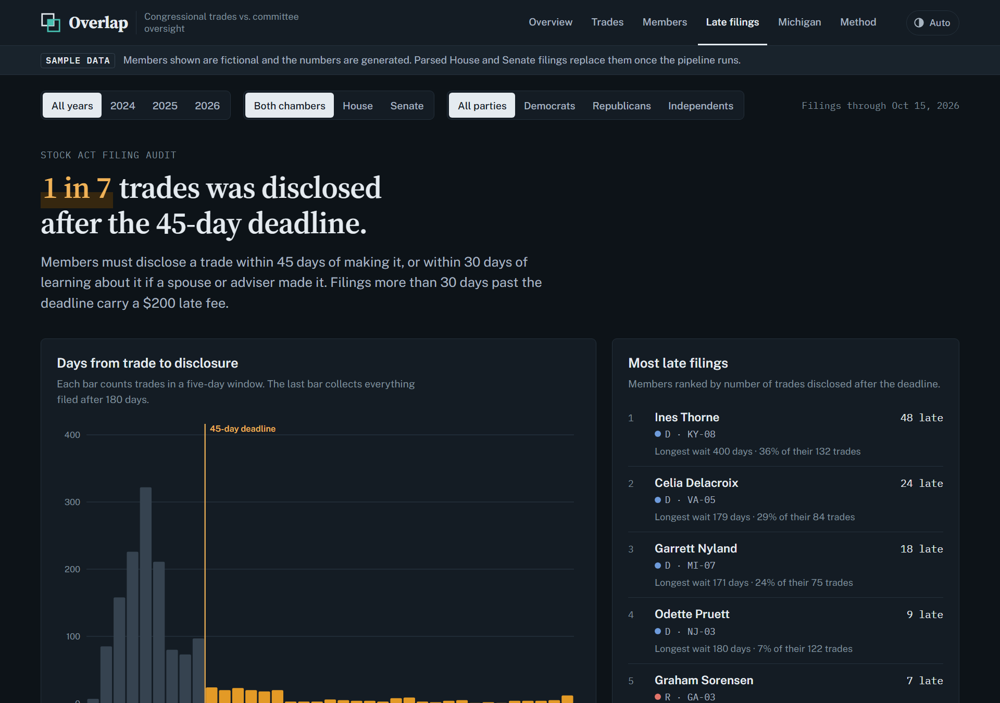
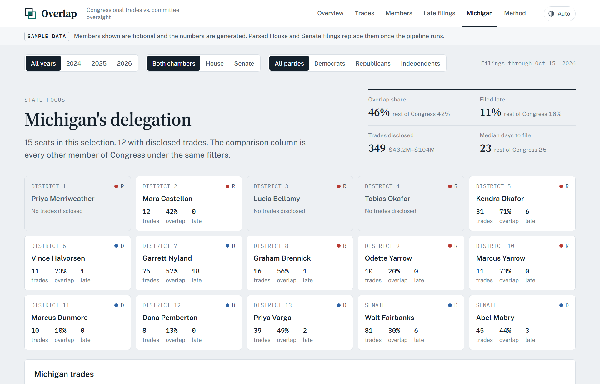

# Overlap: Does Congress trade what it regulates?

An end-to-end data engineering project that collects congressional stock trade
disclosures, matches each trade to the committees the member sat on, and asks
whether members trade more often in the industries their own committees
oversee. It also audits STOCK Act filing deadlines and takes a close look at
Michigan's delegation.

> **Findings describe patterns in public disclosures. They are not evidence
> that any member misused information.**



<sub>The dashboard currently runs on generated sample data with fictional members. See [Project status](#project-status).</sub>

---

## Contents

- [The questions](#the-questions)
- [Project status](#project-status)
- [Architecture](#architecture)
- [Tech stack](#tech-stack)
- [The dashboard](#the-dashboard)
- [Methodology](#methodology)
- [Data model](#data-model)
- [Data quality checks](#data-quality-checks)
- [Run it locally](#run-it-locally)
- [Repository layout](#repository-layout)
- [Roadmap](#roadmap)
- [Data sources](#data-sources)

## The questions

Since the STOCK Act of 2012, members of Congress must publicly disclose stock
trades over $1,000 within 45 days. The disclosures are public but scattered
across two chamber websites, some are scanned PDFs, and amounts are reported
only as ranges such as "$1,001 – $15,000". This project turns them into a
clean, tested dataset and answers four questions:

1. **Committee overlap.** Do members trade more often in industries their own
   committees oversee than they would by chance?
2. **Filing compliance.** How often are trades disclosed after the 45-day
   deadline, and by whom?
3. **Performance.** How did those trades do against the S&P 500 (SPY) over
   the following 30 and 90 days?
4. **Michigan.** What do all of these look like for Michigan's 15-member
   delegation?

## Project status

The project is built in reviewed sections. Every design decision is written up
in the [design report](docs/design-report.md) ([PDF](docs/design-report.pdf)).

| Part | Status |
|---|---|
| Project skeleton, config and tests | ✅ Done |
| Local Airflow 3 in Docker, with dbt installed | ✅ Done and verified (smoke-test DAG passes) |
| Public dashboard (static site) | ✅ Done, running on **sample data** |
| Extraction: House and Senate disclosures to Google Cloud Storage | 🔜 Next |
| PDF parsing, reference data, prices | Planned |
| BigQuery load, dbt models and tests | Planned |
| Export to the dashboard, CI/CD with GitHub Actions | Planned |
| Power BI report | Planned |

## Architecture



Each storage layer has one job:

| Layer | Holds | Why it exists |
|---|---|---|
| **GCS landing** | Every source file, byte for byte | Re-parse history with a better parser without re-downloading; proves where each row came from |
| **BigQuery `raw`** | Parsed rows, values untouched, plus load metadata | One place dbt reads from; cleaning bugs are recoverable |
| **`staging` / `marts`** (dbt) | Cleaned, typed, tested, modeled tables | What the dashboard and Power BI read |

## Tech stack

| Tool | Role | Why this choice |
|---|---|---|
| **Python 3.12** | Extraction, PDF parsing, loading | Business logic lives in an installable package (`src/congress_trades`) that unit-tests without Airflow |
| **Apache Airflow 3.3** | Daily scheduling, retries, backfills | Runs locally in Docker with LocalExecutor; DAGs stay thin and only orchestrate |
| **Google Cloud Storage** | Raw file landing zone | Cheap, durable, and BigQuery loads from it for free |
| **BigQuery** | Warehouse | Serverless, with a free tier that fits this project |
| **dbt Core 1.12** | Transformations, tests, snapshots | Installed in its own virtualenv inside the Airflow image to avoid dependency conflicts |
| **GitHub Actions** | CI (lint, tests, dbt build) and publishing the dashboard | Free for public repos |
| **HTML / CSS / JS** | Public dashboard | The data changes once a day, so a static site on GitHub Pages is free, fast and needs no server |
| **Power BI** | Analyst-facing report | Industry-standard BI tool alongside the public site |

## The dashboard

`frontend/` is a dependency-free static site that reads a single JSON file and
computes every metric in the browser, so the year, chamber and party filters
update every number instantly.

| View | What it shows |
|---|---|
| **Overview** | The headline overlap rate against a chance baseline, overlap by committee, trades by month, latest filings |
| **Trades** | A searchable, filterable feed of every transaction |
| **Members** | A sortable leaderboard; select a member for a profile with committees and industry mix |
| **Late filings** | A distribution of days-to-disclose against the 45-day deadline, plus the members with the most late filings |
| **Michigan** | The full delegation, compared with the rest of Congress |
| **Method** | Sources, definitions and pipeline health |

<table>
<tr>
<td></td>
<td></td>
</tr>
</table>

Design notes: each view leads with the finding stated as a sentence; one accent
color always means "overlap" and amber always means "late"; amounts are drawn
as the disclosed band rather than an invented exact figure; light, dark and
auto themes; works at phone width.

## Methodology

**Amounts are ranges.** Members report one of ten value bands, not exact
amounts. The project keeps the band, shows totals as *sum of floors – sum of
ceilings*, and uses a midpoint only for sorting.

**Overlap.** Each stock gets an industry from its SEC SIC code. A hand-built
table maps industries to the House and Senate committees with jurisdiction. A
trade is an *overlap* when the member sat on one of those committees on the
trade date.

**Expected overlap (the chance baseline).** A high overlap rate can just mean a
committee oversees popular sectors. So for every trade, the project takes the
share of *all* congressional trading that falls in that member's overseen
industries, then averages across trades. The gap between observed and
expected is the signal.

**Late filings.** `days_to_file = filed_date − trade_date`. Anything over 45
days is flagged. (A spouse's trade has 30 days from when the member learns
of it, which the data cannot always see, so this is an upper bound on lateness.)

**Returns.** Close-to-close return over 30 and 90 days after the trade, minus
SPY over the same window.

## Data model

Planned star schema in the `marts` dataset:

| Table | Grain |
|---|---|
| `fact_trades` | One row per disclosed transaction, with amount band, days to file, overlap flag and excess returns |
| `fact_prices` | One row per ticker per trading day |
| `dim_member` | One row per member version (SCD Type 2 via dbt snapshots) |
| `dim_committee` | One row per committee |
| `bridge_member_committee` | Which member sat on which committee, and when |
| `dim_security` | Ticker, company, SIC industry |
| `map_industry_committee` | The hand-built industry-to-committee jurisdiction mapping |

## Data quality checks

Planned as dbt tests and pipeline checks:

- **Amendments:** amended reports replace the original filing instead of duplicating trades
- **Ticker matching:** unmatched tickers are logged with a table of manual fixes
- **Date sanity:** no trade dated after its filing date; no missing prices for traded tickers
- **Reconciliation:** every parsed trade traces back to a source file in GCS
- **Scanned filings:** routed to manual review before their trades are counted

## Run it locally

### Dashboard (no setup needed)

```bash
python3 -m http.server 8000 -d frontend
# open http://localhost:8000
```

A local server is needed because browsers block a page from loading its data
file when opened straight from disk. To regenerate the sample data:

```bash
python3 frontend/scripts/make_sample_data.py
```

### Pipeline

Prerequisites: Docker Desktop (4 GB+ memory), Python 3.12+, `make`.

```bash
cp .env.example .env          # fill in GCP project, bucket and contact email
make setup && make test       # local virtualenv, unit tests
make up                       # build the image and start Airflow at http://localhost:8080
make smoke                    # trigger the setup-check DAG
make down                     # stop
```

Google Cloud setup (project, bucket, service account) is described step by
step in the [design report](docs/design-report.md#4-google-cloud-setup). The
service account key goes in `credentials/`, which is gitignored.

## Repository layout

```
.
├── dags/                    Airflow DAGs (orchestration only)
├── src/congress_trades/     Python package: config, extract, parse, load
├── tests/                   pytest unit tests
├── docker/                  Airflow image (with dbt in its own virtualenv)
├── frontend/                Static dashboard
│   ├── index.html · styles.css · app.js
│   ├── data/dashboard.json  Data the site reads (sample for now)
│   └── scripts/             Sample data generator
├── credentials/             GCP key goes here (gitignored)
├── docs/                    Design report (Markdown + PDF) and screenshots
├── docker-compose.yaml      Local Airflow stack
├── Makefile                 Common commands
└── pyproject.toml           Package, test and lint config
```

## Roadmap

- [x] Skeleton, config, local Airflow with dbt
- [x] Public dashboard on sample data
- [ ] House disclosures: yearly index and raw files to GCS
- [ ] Parse House periodic transaction reports (text and scanned PDFs)
- [ ] Senate eFD: search, download and parse
- [ ] Reference data: members, committees, SEC tickers and SIC codes
- [ ] Industry-to-committee mapping table
- [ ] Daily prices and SPY benchmark
- [ ] Load to BigQuery `raw`
- [ ] dbt staging models and tests
- [ ] dbt marts and committee-membership snapshots
- [ ] Analysis models: overlap, late filings, returns, Michigan
- [ ] Export marts to `dashboard.json`; CI and GitHub Pages deploy with GitHub Actions
- [ ] Power BI report

## Data sources

- [House Clerk financial disclosures](https://disclosures-clerk.house.gov/FinancialDisclosure): periodic transaction reports
- [Senate electronic financial disclosures](https://efdsearch.senate.gov/): periodic transaction reports
- [unitedstates/congress-legislators](https://github.com/unitedstates/congress-legislators): members and committee assignments
- [SEC EDGAR](https://www.sec.gov/search-filings/edgar-search-tools): tickers, company names and SIC codes
- Daily prices: yfinance or Stooq

---

Built by [@ojhnny](https://github.com/ojhnny) as a data engineering portfolio project.
